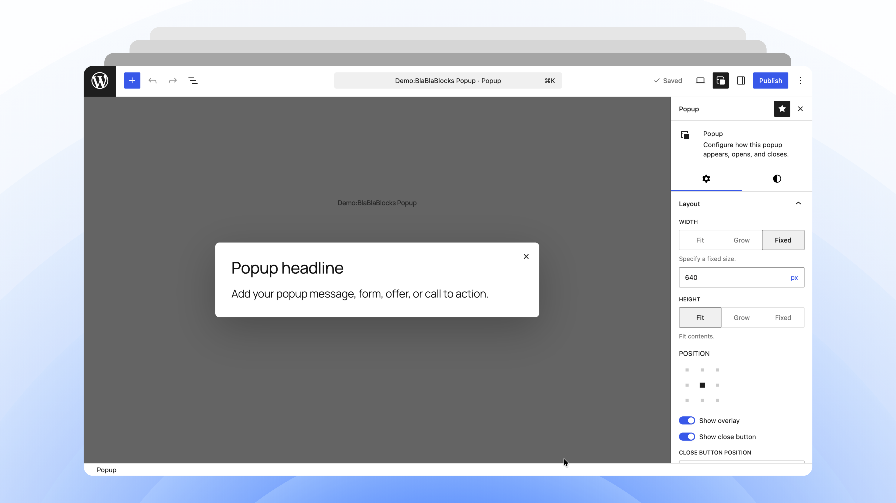

<!-- @format -->

<p align="center">
  
</p>



[![Playground Demo Link](https://img.shields.io/badge/Live%20Preview-3858e9?style=for-the-badge&logo=data%3Aimage%2Fsvg%2Bxml%3Bbase64%2CCjxzdmcgeG1sbnM9Imh0dHA6Ly93d3cudzMub3JnLzIwMDAvc3ZnIiB3aWR0aD0iMTAwIiBoZWlnaHQ9IjEwMCIgZmlsbD0ibm9uZSI%2BPHBhdGggZmlsbD0iI2ZmZiIgZmlsbC1ydWxlPSJldmVub2RkIiBkPSJNMTEuOSAzNi40MjVjLTIuMTgxIDMuMDA3LTMuMzMyIDYuNzAzLTMuNTE3IDEwLjc2NWEyNi40MyAyNi40MyAwIDAgMC0uMDE0IDEuOTk4Yy4yNzYgOS4xMzggNS4xMzQgMTkuNzggMTMuODk4IDI4LjU0NEMzNS42NzggOTEuMTQ0IDUzLjQ5MiA5NS40MSA2My41NzUgODguMWMtNC4yNDEtMS04LjUzMi0yLjU1OC0xMi43NTctNC42MzVhMjMuMDE5IDIzLjAxOSAwIDAgMS0zLjUwMi0uNDRjLTIuMTM5LS40MjctNC40LTEuMTYxLTYuNzAzLTIuMjA2LTQuMjEzLTEuOTEtOC41NjgtNC44NTctMTIuNTcyLTguODYxLTQuMDA0LTQuMDA0LTYuOTUtOC4zNTgtOC44Ni0xMi41Ny0xLjA0NS0yLjMwNC0xLjc4LTQuNTY2LTIuMjA3LTYuNzA0YTIzLjAwNiAyMy4wMDYgMCAwIDEtLjQzOS0zLjUwMWMtMi4wNzgtNC4yMjYtMy42MzYtOC41MTctNC42MzYtMTIuNzU4Wm0tOC40MDEgMjUuNDNjLjMwNS0uMzA1LjYyNS0uNTkuOTYtLjg1NGE1MC4zNzIgNTAuMzcyIDAgMCAwIDMuODY4IDguNTI2Yy0uMjE0Ljk0My0uMjYgMi4yMzUuMDg3IDMuOTY2LjY4OCAzLjQzNyAyLjgzMSA3LjY1NyA2LjYzNCAxMS40NiAzLjgwMiAzLjgwMiA4LjAyMiA1Ljk0NSAxMS40NTkgNi42MzMgMS43MzIuMzQ2IDMuMDI0LjMwMSAzLjk2Ny4wODdBNTAuMzc1IDUwLjM3NSAwIDAgMCAzOSA5NS41NDFjLS4yNjQuMzM0LS41NS42NTUtLjg1NS45Ni02LjM3OCA2LjM3OC0xOS4zMDQgMy43OTMtMjguODcyLTUuNzc0Qy0uMjk0IDgxLjE1OS0yLjg3OSA2OC4yMzMgMy41IDYxLjg1NVptMzEuNzYgMi44ODZDNTQuMzkyIDgzLjg3NSA4MC4yNDUgODkuMDQ2IDkzLjAwMSA3Ni4yOWM0LjYxMy00LjYxMyA2Ljg4MS0xMC45MzcgNi45OTQtMTguMDM3LjE5OC0xMi41MyA2LjMyNy0yNy40OS0xOC41NDMtMzkuNzA2QzYyLjMyLS41ODggMzYuNDY2LTUuNzYtMjMuNzEgNi45OTdjLTQuNjE4IDQuNjItNi44ODcgMTAuOTU0LTYuOTk0IDE4LjA2Ni0uMTg3IDEyLjUzIDYuMzM2IDI3LjQ3MSAxOC41NDMgMzkuNjc4Wm0yNi45NDYgMy4zOTVjLjM1NiAxLjc3Ny40OTIgMy4zODQuNDUgNC44MjctNy4xODUtMi41MDEtMTQuOC03LjE3NC0yMS42MjItMTMuOTk2LTYuODIyLTYuODIyLTExLjQ5NS0xNC40MzctMTMuOTk2LTIxLjYyMyAxLjQ0Mi0uMDQgMy4wNS4wOTUgNC44MjYuNDUgNi4wNSAxLjIxIDEzLjA4MSA0Ljg3MyAxOS4yNzYgMTEuMDY3IDYuMTk0IDYuMTk1IDkuODU3IDEzLjIyNiAxMS4wNjYgMTkuMjc1Wk0yOS40ODQgMTIuNzcyYy0zLjQ1OCAzLjQ1OC01LjMwMiA5LjA4LTQuMzczIDE2LjUyMSA5Ljc4MS0uOTUgMjEuOTczIDMuOTY1IDMxLjgwMiAxMy43OTQgOS44MjggOS44MjggMTQuNzQ1IDIyLjAyIDEzLjc5NCAzMS44MDEgNy40NC45MyAxMy4wNjMtLjkxNSAxNi41Mi00LjM3MiAzLjg0OC0zLjg0NyA1LjY5OC0xMC4zNzYgMy45NTItMTkuMTA0LTEuNzMyLTguNjYyLTYuOTE0LTE4LjUwNS0xNS41LTI3LjA5MS04LjU4Ni04LjU4Ni0xOC40My0xMy43NjgtMjcuMDkxLTE1LjUtOC43MjktMS43NDYtMTUuMjU3LjEwNC0xOS4xMDQgMy45NTFaIiBjbGlwLXJ1bGU9ImV2ZW5vZGQiLz48L3N2Zz4=&logoSize=auto)](https://playground.wordpress.net/?plugin=https://pub-291e873137f04b3a93316bd06776642f.r2.dev/blablablocks-popup.zip&url=/wp-admin/admin.php?page=blablablocks-popup)

## Overview

**BlaBlaBlocks Popup** is a powerful yet lightweight WordPress plugin that empowers you to create and manage dynamic popups seamlessly using the native Block Editor (Gutenberg). No third-party page builders needed!

## Features

- **Block Editor Integration**: Design your popup content entirely within the native WordPress Block Editor.
- **Dedicated Management**: Easily manage all your popups from a clean, dedicated admin screen.
- **Starter Templates**: Jumpstart your design with pre-built variations: 
  - Modal Popup
  - Slide-in Popup
  - Floating Bar
  - Fullscreen Popup
  - Toast / Small Notification
- **Extensive Styling**: Fine-tune layout, position, size, spacing, colors, borders, border radius, and entrance/exit animations.
- **Smart Triggers**: Control exactly *when* popups appear (e.g., page load, scroll depth, inactivity, click count, exit intent).
- **Targeted Display Conditions**: Control *where* popups appear (e.g., entire site, front page, specific posts/pages, archives).
- **Advanced Rules**: Add conditional logic based on page views, sessions, max displays, referrers, login status, user roles, and device types.
- **Popup Lifecycle**: Duplicate, trash, restore, and permanently delete popups with ease.

## Requirements

### Minimum Requirements
- **WordPress**: 6.9 or higher
- **PHP**: 7.4 or higher

### For Development
- **Node.js**: 20.x or higher
- **npm**: for dependency management

## Installation

### Via GitHub (Development / Bleeding Edge)

Clone the repository directly into your WordPress plugins directory:

```bash
cd wp-content/plugins
git clone git@github.com:lubusIN/blablablocks-popup.git
cd blablablocks-popup
npm install
npm run build
```

Then, activate **BlaBlaBlocks Popup** from your WordPress plugins screen.

### Manual Installation

1. Download the latest release or plugin source.
2. Extract and place the plugin folder inside `wp-content/plugins/blablablocks-popup`.
3. If build files are not included, run `npm install` and `npm run build`.
4. Activate **BlaBlaBlocks Popup** from your WordPress plugins screen.

## Usage Guide

1. Navigate to **BlaBlaBlocks Popup** in the WordPress admin sidebar.
2. Click **Add Popup** to create a new one.
3. Enter a descriptive title for your popup.
4. Choose a **starter popup type** to get a base layout.
5. Design the content using your favorite blocks.
6. Use the popup editor sidebar to configure layout, styles, and behavior.
7. Return to the popup admin page to fine-tune settings, triggers, conditions, and display rules.
8. **Publish** the popup when you're ready for it to go live!

## Development

We welcome contributions! Here are the commands you'll need to get started:

Install dependencies:
```bash
npm install
```

Build the plugin assets for production:
```bash
npm run build
```

Watch files and re-compile during development:
```bash
npm run start
```

Start a local WordPress playground environment:
```bash
npm run playground
```

## Meet Your Artisans

[LUBUS](https://lubus.in/?utm_source=github&utm_medium=open-source&utm_campaign=blablablocks-popup) is a web design agency based in Mumbai.

<a href="https://cal.com/lubus">
  
</a>

## License

BlaBlaBlocks Popup is open-source software licensed under the terms in the [LICENSE](LICENSE) file.
